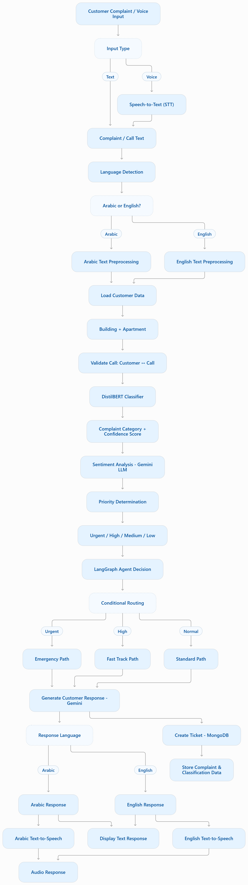
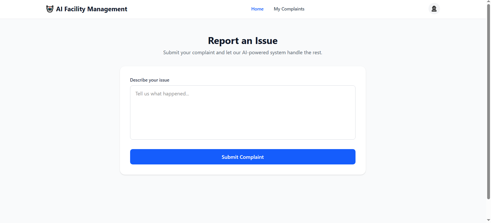
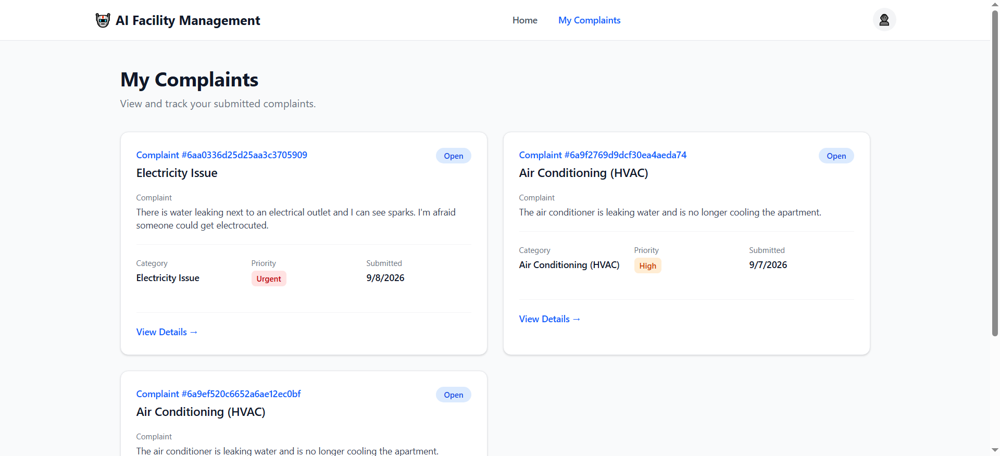
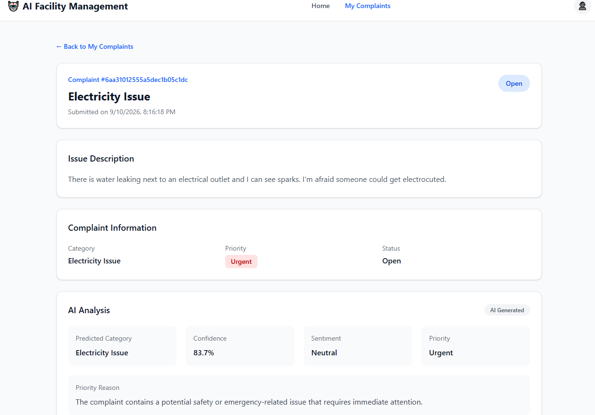
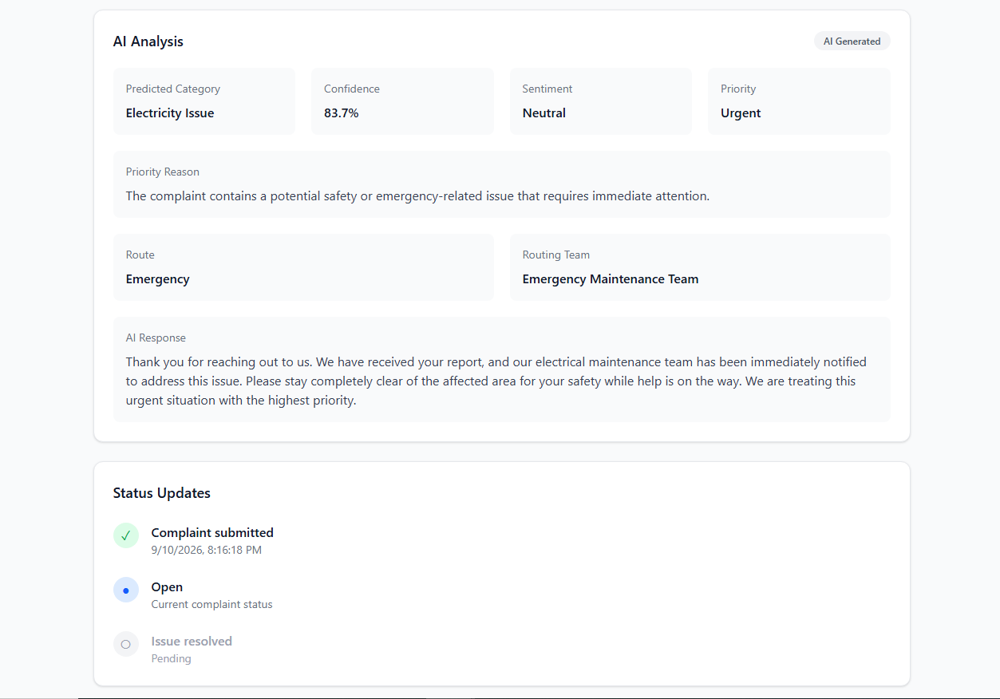

# AI-Powered Facility Management System

An AI-powered multilingual facility management system designed to automate the processing and management of customer complaints and maintenance requests through intelligent workflows and voice-enabled interactions.
The system features an AI Agent built with **LangGraph** to orchestrate the complaint-processing workflow and make decisions at each stage. It supports **Arabic and English**, allowing customers to submit complaints using either text or voice and receive responses in their preferred language.

### Key Features

1. **Complaint Classification:** Classifies customer complaints into facility management categories using a BERT-based NLP classifier, generating category predictions and confidence scores.
2. **Multilingual Support:** Processes complaints in both Arabic and English using language detection and language-specific text preprocessing.
3. **Voice Interaction:** Supports voice-based complaint submission through Speech-to-Text (STT) and generates spoken responses using Text-to-Speech (TTS).
4. **Sentiment Analysis:** Analyzes customer sentiment using Google Gemini.
5. **Priority Assessment:** Determines ticket priority based on issue severity, complaint content, customer sentiment, and classification confidence.
6. **Intelligent Workflow Routing:** Uses LangGraph conditional routing to direct complaints through Urgent, High-Priority, or Standard processing paths.
7. **AI Response Generation:** Generates professional, context-aware customer responses using Google Gemini in Arabic or English.
8. **Ticket Management:** Automatically creates and manages maintenance tickets based on complaint details and assigned priorities.
9. **Authentication & Authorization:** Implements JWT-based authentication to secure API endpoints and manage authenticated customer access.
10. **Database Management:** Stores and manages customer, call, apartment, building, and ticket information in MongoDB.
11. **RESTful API:** Provides backend services and endpoints using FastAPI.
12. **Web Interface:** Offers a React-based interface for submitting complaints, interacting with the AI agent, and monitoring maintenance tickets.

## AI Pipeline

## Screenshots
#### Home

The main dashboard provides an overview of the facility management system, and allows users to access the complaint management workflow.

#### Complaints

Users can view and monitor their submitted maintenance complaints, including ticket status, priority, and category.

#### Complaint Details

Provides detailed information about an individual complaint, including the detected category, priority, status, AI-generated response, and complaint information.

## Future Improvements
- Improve the AI-powered ticket classification and priority detection.
- Enhance the generated AI responses to provide more contextual and personalized replies.
- Add new facility management features and expand the supported complaint categories.
- Improve the overall system performance, reliability, and user experience.
- Expand multilingual capabilities to support additional languages.

## Technologies

AI Agent: LangGraph

NLP Classification: DistilBERT / Hugging Face Transformers

LLM: Google Gemini

Backend: FastAPI / Python

Database: MongoDB / PyMongo

Frontend: React / Tailwind CSS
